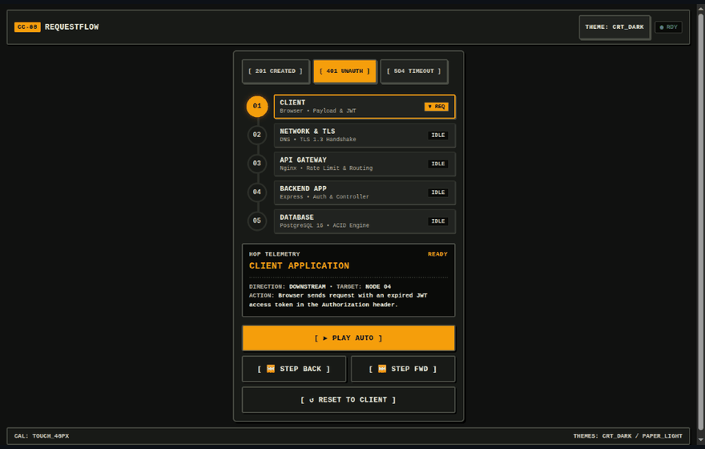

# RequestFlow — Interactive Web Architecture Lab

[](https://github.com/NatsuDrag9/request-flow)
[](dist/index.html)
[](https://requestflow-v0o76jkwr0.cloudcrane.ai/)

**RequestFlow** is a fun, hands-on visual laboratory that shows you what happens behind the scenes every time you tap a button or load a page on the internet. 

When you click "Buy Now" on your phone, your request travels through many servers, security guards, and databases before coming back with a response. RequestFlow lets you watch this journey step by step, inspect the data moving through the wires, and change the rules in real time to see what breaks.

---

## Quick Preview



> 💡 **Try it live in your browser**: [https://requestflow-v0o76jkwr0.cloudcrane.ai/](https://requestflow-v0o76jkwr0.cloudcrane.ai/)

---

## Table of Contents

1. [The 6 Stations of a Web Request](#the-6-stations-of-a-web-request)
2. [How to Use the App](#how-to-use-the-app)
   - [Choose Your View](#choose-your-view)
   - [Playback Controls](#playback-controls)
   - [Look Inside the Data (Wire Inspector)](#look-inside-the-data-wire-inspector)
   - [Break and Tweak Things (⚙ LAB)](#break-and-tweak-things--lab)
   - [Learn Along the Way (ℹ SCENARIO INFO)](#learn-along-the-way--scenario-info)
   - [Change Themes (Dark CRT vs. Light Paper)](#change-themes)
3. [The 8 Scenarios](#the-8-scenarios)
4. [Running the App on Your Computer](#running-the-app-on-your-computer)
5. [How It Was Built](#how-it-was-built)

---

## The 6 Stations of a Web Request

RequestFlow splits the journey of a web request into 6 clear steps:

```
┌──────────────┐     ┌──────────────┐     ┌──────────────┐
│  STATION 01  │ ──▶ │  STATION 02  │ ──▶ │  STATION 03  │
│  Your Phone  │     │ DNS & TLS    │     │Load Balancer │
│  or Browser  │     │(Find & Lock) │     │(Traffic Cop) │
└──────────────┘     └──────────────┘     └──────────────┘
                                                 │
                                                 ▼
┌──────────────┐     ┌──────────────┐     ┌──────────────┐
│  STATION 06  │ ◀── │  STATION 05  │ ◀── │  STATION 04  │
│   Database   │     │Backend Server│     │ API Gateway  │
│  (The Vault) │     │ (The Brain)  │     │ (Front Door) │
└──────────────┘     └──────────────┘     └──────────────┘
```

1. **Station 01: Client (Your Phone or Laptop)**  
   Where the request starts. When you click a button, your browser packages what you want (headers, login keys, and order details) and gets ready to send it.

2. **Station 02: DNS & Security (Finding & Locking the Connection)**  
   Looks up the website's address on the internet (DNS) and creates a secure, encrypted tunnel (TLS 1.3) so no one in the middle can read or steal your information.

3. **Station 03: Load Balancer (The Traffic Cop)**  
   Big websites have dozens of servers. The load balancer makes sure traffic is shared fairly so no single computer gets overwhelmed.

4. **Station 04: API Gateway (The Front Door)**  
   The bouncer of the system. It blocks spam clicks (rate limiting), remembers recent orders so you don't get charged twice, and attaches a tracking tag to your request.

5. **Station 05: Backend Server (The Brain)**  
   Runs the business rules. It checks who you are (your login token) and what you are allowed to do (e.g. an Admin can delete things, but a Viewer can only read).

6. **Station 06: Database (The Vault)**  
   Where data is saved permanently. It handles safe transactions, locks records so two people don't buy the same last ticket, and confirms when your data is saved.

---

## How to Use the App

### Choose Your View
At the top of the screen, you can switch between two visual styles:
* **`NETWORK`**: An interactive 2.5D map showing the data packet traveling along glowing wires between computers.
* **`SEQUENCE`**: A clean vertical subway line showing each station one after another.

### Playback Controls
Use the control bar at the bottom to control the simulation:
* **`[ ▶ PLAY AUTO ]`**: Sits back and lets the packet travel automatically.
* **`[ ⏸ PAUSE ]`**: Freezes the simulation at any moment.
* **`[ ⏭ STEP FWD ]`**: Moves the packet forward by one step so you can study what just happened.
* **`[ ⏮ STEP BACK ]`**: Moves the packet backward by one step.
* **`[ ↺ RESET ]`**: Brings the packet back to the start.

### Look Inside the Data (Wire Inspector)
Want to see what servers actually say to each other?
* Tap **`[ 🔍 INSPECT WIRE ]`** or tap any station node on the map.
* A bottom drawer opens showing:
  * **`📖 OVERVIEW`**: A simple explanation of what this station is doing right now.
  * **`⚡ WIRE TELEMETRY`**: The exact HTTP headers, JSON messages, status codes, and database SQL queries moving through the wire.
  * **`[ 📋 COPY ]`**: Copies the raw data to your clipboard with one click.

### Break and Tweak Things (`⚙ LAB`)
Want to see what happens when things go wrong? Tap **`⚙ LAB`** in the top navigation bar to open the live laboratory drawer:

| Control | What You Can Switch | What Happens in the System |
| :--- | :--- | :--- |
| **Rate Limiter** | `ON` or `OFF` | Turn it OFF to see what happens when too many requests hit the front door. The gateway stops the request with error `429 Too Many Requests`. |
| **User Role** | `Viewer`, `Member`, or `Admin` | Change who is making the request. A `Viewer` gets blocked with error `403 Forbidden`, while an `Admin` is allowed through. |
| **DB Latency** | `Normal` or `1.5s Lag` | Make the database slow to see how timeouts (`504 Gateway Timeout`) and slow queries work. |
| **Concurrency** | `Idempotent` or `CAS Lock` | Test race conditions when two people try to update the same record at the same time (`409 Conflict`). |

* Tap **`[ 💾 SAVE CONFIG ]`** to save your custom lab rules for that scenario.
* Tap **`[ ↺ RESET CONFIG ]`** to go back to default settings anytime.

### Learn Along the Way (`ℹ SCENARIO INFO`)
Tap **`[ ℹ SCENARIO INFO ]`** to open a friendly guide explaining the current scenario.
* If you changed something in the **`⚙ LAB`**, a **glowing amber light** appears on the button, and the guide will show an **Active Lab Override** banner explaining how your changes will alter the result!

### Change Themes
Tap **`THEME`** in the top right to switch between two retro designs:
* **`CRT_DARK`**: Vintage green and amber terminal with glowing screen effects.
* **`PAPER_LIGHT`**: Clean blueprint paper style with crisp lines.

---

## The 8 Scenarios

RequestFlow comes with 8 built-in scenarios that teach key concepts in web development:

### 1. Happy Path (Standard Checkout)
* **What happens**: A regular, successful request.
* **Result**: `201 Created`
* **Journey**: Passes through all 6 stations smoothly. The database saves the order and sends back a success message.
* **Try this in the Lab**: Turn Rate Limiter to `OFF`. Notice how the request gets stopped early at Station 04 with a `429` error before it can even reach the database!

### 2. Expired Login Token
* **What happens**: The user's login session has expired.
* **Result**: `401 Unauthorized`
* **Journey**: Passes through the load balancer and gateway, but gets stopped at Station 05 (Backend) because the login token is no longer valid. The database is never touched.

### 3. Permission Denied (Viewer Role)
* **What happens**: A user logged in as a "Viewer" tries to buy or delete something.
* **Result**: `403 Forbidden`
* **Journey**: The server knows who the user is, but stops the request at Station 05 because Viewers don't have permission to change data.
* **Try this in the Lab**: Open the Lab and switch the role to `Admin`. Run it again and watch it succeed!

### 4. Too Many Requests (Rate Limiter)
* **What happens**: Someone is clicking a button too fast or a bot is flooding the website.
* **Result**: `429 Too Many Requests`
* **Journey**: Station 04 (API Gateway) counts requests. When the bucket is empty, it immediately rejects the request with a `Retry-After: 1s` message, protecting all servers behind it.
* **Try this in the Lab**: Open the Lab and switch Rate Limiter to `ON`. Run it again and watch the request pass!

### 5. Database Line Too Long (Timeout)
* **What happens**: All database connections are busy, so the request has to wait in line too long.
* **Result**: `504 Gateway Timeout`
* **Journey**: The request reaches the database (Station 06), but all 20 connections are in use. The waiting time passes the safe limit, so the gateway cancels the request.
* **Try this in the Lab**: Open the Lab and set DB Latency back to `Normal (15ms)`. Run it again and watch it finish on time!

### 6. Slow Database Query
* **What happens**: The database has to search through millions of rows without an index.
* **Result**: `200 OK (Degraded)`
* **Journey**: The request finishes successfully, but it takes 1.2 seconds instead of a few milliseconds. You will see a warning badge showing that the query was slow.

### 7. Duplicate Request (Already Saved)
* **What happens**: You accidentally hit "Submit" twice on a payment page.
* **Result**: `200 OK (Cache Replay)`
* **Journey**: The API Gateway remembers the unique request key from your first click. Instead of charging you twice or hitting the database again, it instantly returns the saved result from its cache!

### 8. Two People Buying the Last Item (Race Condition)
* **What happens**: Two shoppers click "Buy" on the very last item in stock at the exact same fraction of a second.
* **Result**: `409 Conflict`
* **Journey**: Both reach the database, but the database checks the version number. The first shopper wins, and the second shopper gets a conflict error so items are never oversold.
* **Try this in the Lab**: Switch Concurrency Control to `Idempotent (UUID)` in the Lab to see how safe keys prevent accidental collisions.

---

## Running the App on Your Computer

You can easily run RequestFlow locally on your own machine.

### Requirements
* **Node.js** (version 20 or newer)
* **npm** (comes with Node.js)

### Step 1: Download the Project
```bash
git clone https://github.com/NatsuDrag9/request-flow.git
cd request-flow
```

### Step 2: Install Dependencies
```bash
npm install
```

### Step 3: Run the Automated Tests
```bash
npm test
```
All 56 unit and integration tests will run and pass!

### Step 4: Build the App
```bash
npm run build
```
This bundles everything into a single, self-contained `dist/index.html` file (~108 KB).

### Step 5: Start the Local Server
```bash
npm run preview
```
Now open [http://localhost:4173/](http://localhost:4173/) in your web browser to play with the app!

---

## How It Was Built

* **Zero Heavy Frameworks**: Built with modern standard web components (Vanilla TypeScript, HTML5, and CSS3). Loads instantly with no loading spinner.
* **Single File Bundle**: Everything (HTML, CSS, JavaScript, icons, and SVG graphics) is compiled into a single file of just **108 KB**.
* **Completely Private & Safe**: All simulations run right in your browser. No data is sent to external tracking servers.
* **Mobile-Friendly**: Works smoothly on mobile phones, tablets, and desktop computers with touch gestures and safe screen sizing.
* **Saved Progress**: Your completed scenarios, custom lab settings, and theme choices are automatically saved in your browser's local storage.

---

## License

MIT License © 2026 RequestFlow Authors
