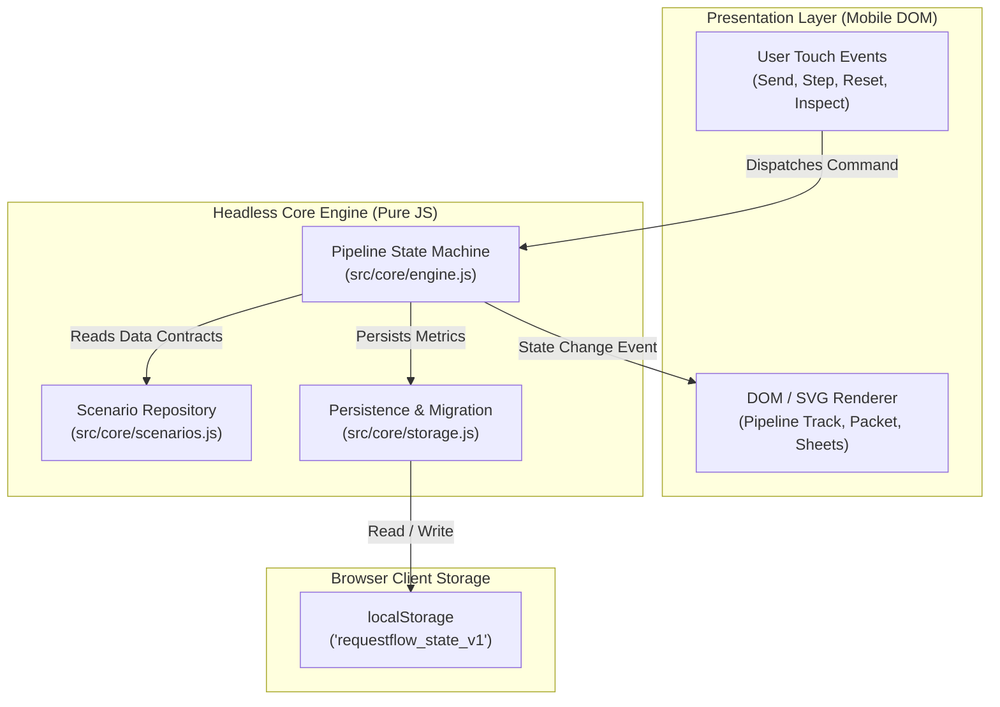
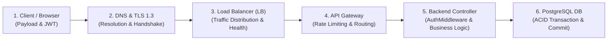
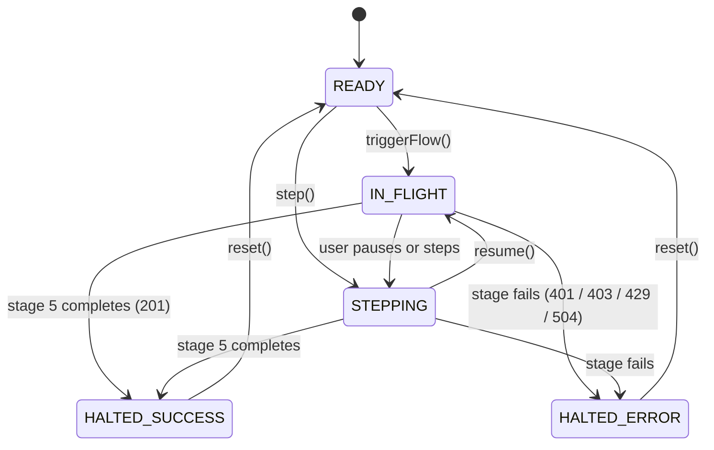

# RequestFlow System Architecture

This document defines the system topology, module boundaries, data flows, and state machine contracts for **RequestFlow**.

---

## 1. Architectural Philosophy: Decoupled Headless Core

To support strict Test-Driven Development (TDD) and ensure instant mobile performance, RequestFlow is architected with a **strict separation between logic and rendering**:

1. **Headless Core (`src/core/`)**: Pure, deterministic JavaScript. Contains all state machines, pipeline step calculations, scenario definitions, and data migration logic. **Zero dependencies on the DOM (`window`, `document`)**, allowing 100% of the core logic to be unit-tested in Vitest without browser mocks.
2. **UI & Presentation Layer (`src/ui/`)**: Subscribes to events emitted by the core engine and updates DOM nodes, SVG paths, and bottom sheets.
3. **Single-File Packaging (`scripts/bundle.js`)**: Compiles modular source files into a single, self-contained `dist/index.html` ($<1\text{ MB}$, zero external CDNs) for CloudCrane deployment.

---

## 2. High-Level System Topology



---

## 3. The 6-Node Request Pipeline Model

RequestFlow models the full journey of an HTTP transaction across 6 distinct architectural layers:



### Stage Specifications

| Index | Stage ID | Architectural Role | Simulated Wire Data |
| :--- | :--- | :--- | :--- |
| **0** | `client` | Initiates HTTP request | `POST /api/v1/orders`, `Authorization: Bearer <jwt>`, JSON body |
| **1** | `dns_tls` | Resolves IP & establishes session | DNS A Record (`api.store.com`), TLS 1.3 1-RTT Handshake |
| **2** | `lb` | Load Balancer (L4/L7 Traffic Distribution) | Target health check status, Round Robin instance selection, `X-Forwarded-For` |
| **3** | `gateway` | API Perimeter & Gateway | Token Bucket rate limiter (429), Idempotency key lookup, path routing |
| **4** | `backend` | Runs auth validation & business logic | JWT signature verification, RBAC permissions (403), controller execution |
| **5** | `database` | Persistent storage execution | `BEGIN; INSERT INTO orders...; COMMIT;`, connection pool |

### Node Lifecycle States
Every node in the pipeline reflects one of four discrete visual states:
- `IDLE`: Node has not been reached by the current request packet.
- `ACTIVE`: The packet is currently at this node; active processing is underway.
- `PASSED`: Processing at this node succeeded; packet has moved to the next stage.
- `FAILED`: Request processing halted at this node due to an error (e.g. 401 at Backend, 504 at Database).

---

## 4. Finite State Machine (FSM) Lifecycle

The request simulation is governed by a deterministic state machine in `src/core/engine.js`:



### State Definitions
- **`READY`**: System is idle, ready to accept a new request simulation.
- **`IN_FLIGHT`**: Packet is automatically traversing nodes via a timed interval (default: $700\text{ ms}$ per node).
- **`STEPPING`**: Manual debugger mode; packet advances strictly one node per user tap.
- **`HALTED_SUCCESS`**: Packet reached the final node and successfully returned a response (e.g., `201 Created`).
- **`HALTED_ERROR`**: Request failed at a specific stage (e.g., AuthMiddleware rejected expired token with `401 Unauthorized`), halting execution before reaching subsequent layers.

---

## 5. Persistence & Schema Contract

All client-side persistence is managed by `src/core/storage.js`.

### v1 Schema Contract
```json
{
  "version": 1,
  "totalRequests": 0,
  "inspectedStages": [],
  "selectedScenario": "happy"
}
```

### Persistence Invariants
1. **Isolated Key**: Keyed exclusively under `requestflow_state_v1`.
2. **Graceful Fallbacks**: If `localStorage` is disabled, throws a quota error, or contains corrupt JSON, the engine falls back to an in-memory state without crashing.
3. **Migration Readiness**: Future schema versions must inspect `parsed.version` and apply transformation pipelines without mutating or deleting existing user metrics.

---

## 6. Directory Structure & Module Boundaries

```
cloud-crane/
├── ARCHITECTURE.md            # System architecture & data flows (This document)
├── AGENTS.md                  # Development rules, TDD mandate, and platform constraints
├── intent.md                  # Project purpose and evaluation criteria
├── features/                  # Feature specifications and implementation plans
│   ├── 01-pipeline-explorer/  # Core animated 5-node pipeline & controls
│   ├── 02-stage-inspector/    # Bottom-sheet drawer with Overview & Wire Protocol
│   └── 03-state-persistence/  # LocalStorage tracking & migration engine
├── src/
│   ├── core/                  # Pure Headless Business Logic (Zero DOM dependencies)
│   │   ├── engine.js          # Pipeline FSM & execution runner
│   │   ├── scenarios.js       # Scenario configurations & wire data payloads
│   │   └── storage.js         # LocalStorage persistence & schema validator
│   └── ui/                    # Presentation Layer (Mobile Touch & DOM)
│       ├── styles.css         # Design tokens, safe-area insets, mobile layout
│       └── app.js             # Event listeners, DOM manipulation, sheet toggling
├── tests/
│   ├── unit/                  # Vitest headless unit tests
│   │   ├── engine.test.js     # FSM transitions, bounds, failure halt points
│   │   ├── scenarios.test.js  # Wire data integrity, HTTP status validation
│   │   └── storage.test.js    # Persistence, error fallback, schema validation
│   └── integration/           # Vitest integration tests
│       └── pipeline.test.js   # End-to-end simulation runs from Client to DB
├── scripts/
│   └── bundle.js              # Compiles src/ into self-contained dist/index.html
└── dist/
    └── index.html             # Final self-contained bundle for CloudCrane (< 1 MB)
```

---

## 7. CloudCrane Platform Constraints & Compliance

- **Single Self-Contained Bundle**: The production distribution `dist/index.html` bundles all HTML, CSS, and JS inline.
- **Zero External Network Requests**: No external CDNs, fonts, or scripts. Everything is locally bundled or provided by CloudCrane shelf libraries.
- **Safe Area & Viewport**: Uses `100dvh` for viewport height and respects `env(safe-area-inset-top)` and `env(safe-area-inset-bottom)`.
- **Naming Rule**: The identifier `open` is never used at top-level scope to avoid collision with CloudCrane's host environment.
