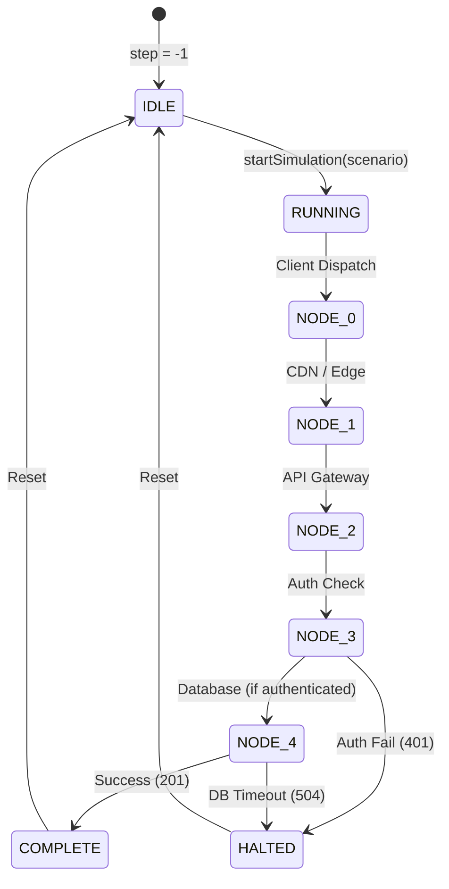

# System Architecture & State Machine

## 1. Architectural Principles
1. **Decoupled Business Logic**: Pure simulation engine and schema migration logic live in `src/core/` with zero DOM or browser API dependencies. This enables 100% unit-testability in headless Node.js.
2. **Single-File Distribution**: Mobile apps on CloudCrane require a single self-contained HTML file (`dist/index.html`). Development occurs across modular source files (`src/core/`, `src/ui/`), which are automatically compiled by `scripts/bundle.js`.

## 2. Component Boundaries

```
src/
├── core/
│   ├── engine.js          # State machine and step progression logic
│   ├── storage.js         # LocalStorage abstraction with schema migration
│   └── scenarios.js       # Wire protocol payloads and status codes
└── ui/
    ├── styles.css         # Safe-area insets, dark theme, responsive touch targets
    └── index.template.html# App shell linking visual canvas with engine
```

## 3. Engine State Machine

The pipeline engine operates as a deterministic finite state machine (FSM):



### State Transitions
- **Initial**: `status = 'IDLE'`, `activeStep = -1`.
- **Step Bounds**: Steps advance sequentially `0 -> 1 -> 2 -> 3 -> 4`.
- **Halt Conditions**: Scenarios specify terminal fail nodes where step advancement immediately stops and assigns appropriate HTTP error codes.
