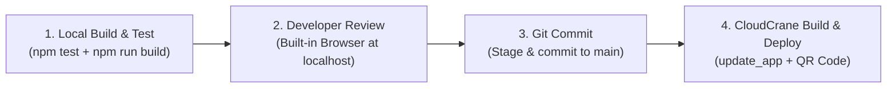

# Project Plan: RequestFlow (Milestone 2 — Interactive Lab & Expanded Scenarios)

This document establishes the execution and verification plan for delivering **Milestone 2** of RequestFlow, strictly aligned with the living functional specification in [docs/SPEC.md](file:///home/rohitimandi/Desktop/Rohit/Personal/Online_Project_Uploads/Interview-Assignments/cloud-crane/docs/SPEC.md) and the architecture defined in [docs/ARCHITECTURE.md](file:///home/rohitimandi/Desktop/Rohit/Personal/Online_Project_Uploads/Interview-Assignments/cloud-crane/docs/ARCHITECTURE.md).

---

## 1. Milestone Objective

Expand RequestFlow from its initial 3-scenario MVP into a comprehensive, mobile-first learning laboratory simulating real-world backend infrastructure patterns:
1. **6-Node Pipeline Topology**: Explicitly model the full path across **Client**, **DNS & TLS 1.3**, **Load Balancer (LB)**, **API Gateway**, **Backend / Auth Controller**, and **PostgreSQL Database**.
2. **Interactive Lab Controls**: Introduce slide-up/inline controls to toggle Token Bucket Rate Limiting, User Roles (RBAC), DB Query Latency, and Concurrency Controls (Idempotency vs CAS).
3. **8-Scenario Catalog with Educational Guidance**: Each scenario includes a mandatory `description` explaining distributed systems mechanics, expected status, and visual observation targets.
4. **Dual Presentation Views**: Maintain seamless toggle between the **2.5D Isometric Network Topology Map** (`[ ❖ NETWORK ]`) and the **Subway Track Sequence** (`[ ☰ SEQUENCE ]`).
5. **Zero-Loss Linear Data Persistence ($v_1 \to v_2 \to v_3$)**: Preserve historical runs, scenario analytics, and lab preferences.

---

## 2. Work Breakdown & Sequencing

### Phase 1: Environment & Tooling Verification
- **Strict TypeScript & TDD**:
  - `npm test`: Executes Vitest headless unit and integration test suite (`vitest run`).
  - `npm run lint`: Strict typecheck (`tsc --noEmit`).
  - `npm run build`: Compiles modular TypeScript sources into self-contained `dist/index.html` ($<1\text{ MB}$, zero external CDNs, safe minification).
  - `npm run validate`: Runs lint $\to$ tests $\to$ bundle verification.

---

### Phase 2: Feature Specifications & TDD Implementation

Each feature follows the AI-native specification pattern (`intent.md`, `spec.md`, `plan.md`) and is implemented using strict Test-Driven Development (writing Vitest unit tests before or alongside code):

#### 1. [Feature 01: Pipeline Lifecycle Explorer](file:///home/rohitimandi/Desktop/Rohit/Personal/Online_Project_Uploads/Interview-Assignments/cloud-crane/src/features/01-pipeline-explorer)
- **6-Node Pipeline Topology Model**:
  - `Node 0 (client)`: Browser request dispatch, HTTP method, headers, Bearer JWT.
  - `Node 1 (dns_tls)`: DNS domain resolution, TLS 1.3 handshake session setup.
  - `Node 2 (lb)`: Load Balancer L4/L7 traffic distribution, health checks, `X-Forwarded-For`.
  - `Node 3 (gateway)`: Perimeter security, Token Bucket rate limiting (429), Idempotency cache.
  - `Node 4 (backend)`: Express/Spring app tier, JWT verification (401), RBAC role checks (403).
  - `Node 5 (database)`: PostgreSQL ACID engine, lock timeout (504), CAS optimistic lock (409).
- **Semantic Scenario Dropdown Selector (Zero Raw Status Codes)**:
  - Scenarios are selected via a prominent retro-styled tactile dropdown button:
    `[ SCENARIO: Happy Path (Standard Checkout) ▾ ]`.
  - Tapping opens a full-width picker drawer / sheet categorizing scenarios by domain:
    - *Authentication & AuthZ*: `Happy Path`, `Expired Bearer Token`, `RBAC Role Restriction (Viewer)`.
    - *Perimeter & Gateway*: `Token Bucket Rate Limiting (429)`, `Idempotency Replay (UUID Cache Hit)`.
    - *Database & Persistence*: `DB Connection Pool Timeout (504)`, `Slow Query Latency (Degraded)`, `CAS Optimistic Concurrency Conflict (409)`.
  - Once selected, the dropdown button text updates to the active scenario name, and the underlying configuration parameters (User Role, Token Bucket, DB Latency, Concurrency) automatically synchronize.
- **Dedicated Scenario Description Modal**:
  - Adds a dedicated `[ ℹ SCENARIO INFO ]` button in the bottom mechanical control bar alongside Play, Step, Inspect Wire, and Reset.
  - Tapping opens a tactile retro-tech modal presenting:
    - **Scenario Title**: Operational pattern name and context.
    - **What Happens**: Comprehensive breakdown of distributed system behavior.
    - **Expected Outcome**: Hop traversal, exact halt node (e.g. Node 4 Backend Controller), and response status.
    - **What to Observe**: Key telemetry indicators in the pipeline and wire inspector.
    - **Dismissal**: Header `[ ✕ ]` button and backdrop dismiss.
- **Interactive Lab Controls (Section 3.2 of SPEC.md)**:
  - Preset Quick-Selector: `Happy Path`, `Rate Limit`, `RBAC Role`, `DB Lag`.
  - Token Bucket Rate Limiter Toggle: `ON` (capacity: 5, refill: 1 token/sec) vs `OFF`.
  - User Role Toggle: `Viewer` (read-only), `Member` (standard checkout), `Admin` (full access).
  - DB Query Latency Toggle: `Normal` (15ms) vs `1.5s Lag` (degraded latency / 504 test).
  - Concurrency Control Toggle: `Idempotent` (UUID deduplication) vs `CAS` (version mismatch).
- **Comprehensive Scenario Catalog (with mandatory `description`)**:
  - **Scenario A (`order_create`)**: Happy path order creation across all 6 nodes.
  - **Scenario B1 (`auth_token_expired`)**: Expired/missing Bearer token caught at Node 4 (Backend).
  - **Scenario B2 (`rbac_restriction`)**: Valid identity but `Viewer` role rejected by RBAC on mutating checkout.
  - **Scenario C (`token_bucket_empty`)**: Token Bucket depletion at Node 3 (Gateway) with `Retry-After: 1`.
  - **Scenario D1 (`db_pool_timeout`)**: Connection pool exhaustion hanging on lock beyond 5000ms SLA.
  - **Scenario D2 (`query_degraded`)**: Degraded database execution (1200ms vs 15ms) returning `200 OK` with `X-Query-Time: 1200ms`.
  - **Scenario E1 (`idempotency_cache`)**: Client `Idempotency-Key` cache hit at Gateway returning replay payload.
  - **Scenario E2 (`optimistic_lock_cas`)**: Concurrent checkout race condition failing CAS version check.
- **Presentation & Animation**:
  - Dual view toggle: Isometric 2.5D SVG Network Map (`[ ❖ NETWORK ]`) & Subway Sequence (`[ ☰ SEQUENCE ]`).
  - Active node glowing amber halo, stationary SVG anchor (0px drift), transit packet pulse, and failure node prominent RED styling (`#ef4444`).

#### 2. [Feature 02: Stage Wire Inspector](file:///home/rohitimandi/Desktop/Rohit/Personal/Online_Project_Uploads/Interview-Assignments/cloud-crane/src/features/02-stage-inspector)
- **Deep Wire Telemetry Formatting**:
  - Pure formatter `formatWireProtocol(nodeIndex, stage, direction)` serializing realistic payloads across all 6 nodes.
  - Formats RBAC role payloads (`required_roles`, `granted_role`).
  - Formats rate limiting telemetry (`Retry-After: 1`, `X-RateLimit-Remaining: 0`).
  - Formats idempotency headers (`X-Idempotency-Status: REPLAY`, `X-Original-Request-Id`).
  - Formats CAS queries (`UPDATE ... WHERE id = ? AND version = ?`, 0 rows affected).
- **Mobile Ergonomics & Integrated Telemetry Copy**:
  - Slide-up bottom sheet with grab handle, dual tabs (*Overview* and *Wire Telemetry*).
  - Borderless, square-free copy icon anchored to top-right of telemetry box (`top: 3px; right: 3px;`) with layered files icon (front layer top-right).
  - Safe area insets and minimum $44\times 44\text{px}$ touch targets.

#### 3. [Feature 03: State Persistence Engine](file:///home/rohitimandi/Desktop/Rohit/Personal/Online_Project_Uploads/Interview-Assignments/cloud-crane/src/features/03-state-persistence)
- **Zero-Loss Linear Migration ($v_1 \to v_2 \to v_3$)**:
  - Pure deterministic migration pipeline preserving legacy counts (`v1.pings` $\to$ `v2.totalRuns` $\to$ `v3.totalRuns`).
  - Tracks individual run counts across all 8 scenarios in `scenarioRuns`.
  - Persists theme preferences (`CRT_DARK` vs `PAPER_LIGHT`) and lab settings.
  - Defensive fallback against disabled storage and quota overflow.

#### 4. Automated Testing Suite (Vitest TDD)
- **Unit Tests**:
  - `tests/unit/scenarios.test.ts`: Asserts all 8 scenarios have valid contracts, non-empty stages, and mandatory `description`.
  - `tests/unit/engine.test.ts`: Verifies FSM transitions, 6-node boundary conditions, pause, and bidirectional stepping.
  - `tests/unit/node-component.test.ts`: Verifies rendering of all 6 nodes, SVG isometric paths, and red error styling.
  - `tests/unit/inspector.test.ts`: Verifies wire formatting for RBAC, rate-limiting, idempotency, and CAS queries.
  - `tests/unit/storage.test.ts`: Asserts 100% backward compatibility across $v_1 \to v_2 \to v_3$ migrations.
- **Integration Tests**:
  - `tests/integration/pipeline.test.ts`: Full end-to-end simulation across all 6 nodes, verifying telemetry and persistence updates.

---

### Phase 3: Assembly, Verification & Deployment Pipeline

Every iteration and feature increment must strictly follow this 4-step build and release lifecycle:

#### Step 1: Build the App Locally
- **Unit & Integration Tests**: Run `npm test` (Vitest) $\to$ **100% pass rate** across all core modules.
- **Bundle Compilation**: Run `npm run build` (`node scripts/bundle.js`) $\to$ Compile modular `src/` into self-contained `dist/index.html` ($<1\text{ MB}$, currently $\sim 58\text{ KB}$) with zero external CDNs.
- **Local Validation**: Run `npm run lint` and `npm run validate` to ensure zero syntax or type errors.

#### Step 2: Human / Developer Review in the Built-in Browser
- Serve `dist/` on the local preview server (`http://localhost:4173/`).
- Inspect and test directly in the IDE built-in browser view.
- Verify 6-node pipeline, lab controls toggles, scenario guidance descriptions, touch targets ($\ge 44\times 44\text{px}$), safe-area insets, theme toggle (CRT dark vs paper light), and interaction responsiveness before committing or deploying.

#### Step 3: Commit the Files
- Once local review is approved, stage all modified source files, tests, and documentation.
- Commit to the git repository on branch **`main`** with a clear semantic commit message documenting changes and test verification results.

#### Step 4: Build & Deploy on CloudCrane
- **Pre-flight Gate**: Call `check_publish` via CloudCrane MCP to ensure **0 problems and 0 warnings**.
- **Deploy**: Call `update_app` with the compiled bundle, blueprint, and release notes.
- **Visual Inspection**: Call `look_at_app` to inspect the live mobile screenshot ($390\times 844$) and verify CloudCrane Quality Score ($\ge 90$).
- **Mobile QR Code Delivery**: Automatically invoke the **`cloudcrane-qr`** skill (`scripts/qr.js`) to generate and display the updated scannable QR code and install card for instant testing on physical mobile devices.

---

### Phase 4: Human-in-the-Loop Mobile Testing

1. Scan the generated QR code with your phone camera to open the CloudCrane URL directly in Safari (iOS) or Chrome (Android).
2. Test touch ergonomics, packet animation pacing (2.0s dwell, 1.0s transit), Lab Controls toggles, and wire telemetry inspection on a physical device.
3. Verify that app reloads cleanly preserve state via $v_3$ persistence.
