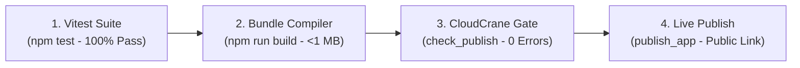

# Project Plan: RequestFlow (Milestone 1 — v1 MVP)

This document establishes the immediate execution plan for delivering **Version 1 (MVP)** of RequestFlow, adhering to the AI-Native SDLC and the architecture defined in [ARCHITECTURE.md](file:///home/rohitimandi/Desktop/Rohit/Personal/Online_Project_Uploads/Interview-Assignments/cloud-crane/ARCHITECTURE.md).

---

## 1. Milestone 1 Objective

Build, test, and deploy a self-contained, mobile-first HTTP lifecycle learning laboratory to CloudCrane, producing a live public URL for real-world phone testing.

---

## 2. Work Breakdown & Sequencing

### Phase 1: Environment & Tooling Setup
- **`package.json`**: Configure Node.js ESM project scripts:
  - `npm test`: Runs Vitest in headless mode (`vitest run`).
  - `npm run test:watch`: Runs Vitest in interactive watch mode (`vitest`).
  - `npm run build`: Executes `node scripts/bundle.js` to compile `src/` into `dist/index.html`.
  - `npm run lint`: Executes syntax validation via `node --check`.
  - `npm run validate`: Runs lint $\to$ tests $\to$ build pipeline.
- **`scripts/bundle.js`**: Build compiler that injects CSS, core JavaScript, and UI templates into a single self-contained `dist/index.html` ($<1\text{ MB}$, zero external CDNs).

---

### Phase 2: Feature Specifications & TDD Implementation

Each feature follows the AI-native specification pattern (`intent.md`, `spec.md`, `plan.md`) and is implemented using strict Test-Driven Development (writing Vitest unit tests before or alongside code):

1. **[Feature 01: Pipeline Lifecycle Explorer](file:///home/rohitimandi/Desktop/Rohit/Personal/Online_Project_Uploads/Interview-Assignments/cloud-crane/features/01-pipeline-explorer)**
   - **Scope**: Vertical subway-style pipeline (5 nodes), deterministic FSM engine (`src/core/engine.js`), packet animation, play/pause/step controls, and 3 scenario presets (`201 Created`, `401 Unauthorized`, `504 DB Timeout`).
   - **Testing**: `tests/unit/engine.test.js` (FSM transitions, step bounds, halt-on-failure behavior) and `tests/unit/scenarios.test.js`.

2. **[Feature 02: Stage Wire Inspector](file:///home/rohitimandi/Desktop/Rohit/Personal/Online_Project_Uploads/Interview-Assignments/cloud-crane/features/02-stage-inspector)**
   - **Scope**: Slide-up bottom sheet with swipe/tap gestures, drag handle, and dual tabs (*Overview* for clear explanations, *Wire Protocol* for raw HTTP headers, JSON payloads, and SQL queries).
   - **Testing**: Verification of inspector data contract and tab switching logic.

3. **[Feature 03: State Persistence Engine](file:///home/rohitimandi/Desktop/Rohit/Personal/Online_Project_Uploads/Interview-Assignments/cloud-crane/features/03-state-persistence)**
   - **Scope**: Client-side storage manager (`src/core/storage.js`) saving total request counts, inspected stages, and scenario preferences with defensive fallback handling.
   - **Testing**: `tests/unit/storage.test.js` (reads, writes, corrupt data recovery, quota exception handling).

4. **Integration Testing**:
   - `tests/integration/pipeline.test.js`: End-to-end simulation asserting that requests traverse nodes sequentially, record timing metrics, and update persistence.

---

### Phase 3: Assembly, Verification & Deployment Gate

Before publishing to CloudCrane, the build must pass the 4-step quality gate:

1. **Automated Vitest Suite**: `npm test` $\to$ **100% pass rate**.
2. **Bundle Verification**: `npm run build` $\to$ Bundle size $<1\text{ MB}$, valid HTML/CSS/JS syntax.
3. **CloudCrane Pre-flight Gate**: Call `check_publish` via CloudCrane MCP $\to$ **0 problems, 0 warnings**.
4. **Publish & Deploy**: Call `publish_app` or `update_app` via CloudCrane MCP $\to$ Returns public install URL.
5. **QR Code Generation**: After every build and publish, automatically generate a scannable QR code image and inline card for the CloudCrane URL to enable instant testing on physical mobile devices.

---

### Phase 4: Human-in-the-Loop Mobile Testing

1. Scan the generated QR code with your phone camera to open the CloudCrane URL directly in Safari (iOS) or Chrome (Android).
2. Tap "Add to Home Screen" to install RequestFlow as a standalone PWA.
3. Test touch ergonomics, packet animation pacing, and sheet interactions.
4. **Observation & Feedback**: Identify pain points, ergonomic friction, or potential improvements directly from physical phone usage to define the next iteration.
