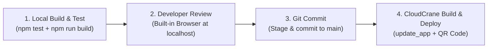

# Project Plan: RequestFlow (Milestone 1 — v1 MVP)

This document establishes the immediate execution plan for delivering **Version 1 (MVP)** of RequestFlow, adhering to the AI-Native SDLC and the architecture defined in [ARCHITECTURE.md](file:///home/rohitimandi/Desktop/Rohit/Personal/Online_Project_Uploads/Interview-Assignments/cloud-crane/ARCHITECTURE.md).

---

## 1. Milestone 1 Objective

Build, test, and deploy a self-contained, mobile-first HTTP lifecycle learning laboratory to CloudCrane, producing a live public URL for real-world phone testing.

---

## 2. Work Breakdown & Sequencing

### Phase 1: Environment & Tooling Setup
- **`package.json`**: Configure Node.js ESM project scripts:
  - `npm test`: Runs Vitest with native TypeScript support (`vitest run`).
  - `npm run test:watch`: Runs Vitest in interactive watch mode (`vitest`).
  - `npm run typecheck`: Runs strict TypeScript type checking (`tsc --noEmit`).
  - `npm run build`: Executes `node scripts/bundle.js` to compile `src/` into `dist/index.html`.
  - `npm run lint`: Executes TypeScript typecheck (`tsc --noEmit`).
  - `npm run validate`: Runs typecheck $\to$ tests $\to$ build pipeline (`npm run lint && npm test && npm run build`).
- **`tsconfig.json`**: Strict ES2022 / NodeNext TypeScript configuration.
- **`scripts/bundle.js`**: Build compiler that packages CSS, TypeScript components (transpiled via esbuild), and templates into a single self-contained `dist/index.html` ($<1\text{ MB}$, zero external CDNs).

---

### Phase 2: Feature Specifications & TDD Implementation

Each feature follows the AI-native specification pattern (`intent.md`, `spec.md`, `plan.md`) and is implemented using strict Test-Driven Development (writing Vitest unit tests before or alongside code):

1. **[Feature 01: Pipeline Lifecycle Explorer](file:///home/rohitimandi/Desktop/Rohit/Personal/Online_Project_Uploads/Interview-Assignments/cloud-crane/features/01-pipeline-explorer)**
   - **Scope**: Vertical subway-style pipeline (5 nodes), deterministic FSM engine (`src/core/engine.js`), packet animation, play/pause/step controls, and 3 scenario presets (`201 Created`, `401 Unauthorized`, `504 DB Timeout`).
   - **Testing**: `tests/unit/engine.test.js` (FSM transitions, step bounds, halt-on-failure behavior) and `tests/unit/scenarios.test.js`.

2. **[Feature 02: Stage Wire Inspector](file:///home/rohitimandi/Desktop/Rohit/Personal/Online_Project_Uploads/Interview-Assignments/cloud-crane/features/02-stage-inspector)**
   - **Scope**: Slide-up bottom sheet with swipe/tap gestures, drag handle, and dual tabs (*Overview* for clear explanations, *Wire Protocol* for raw HTTP headers, JSON payloads, and SQL queries).
   - **Testing**: Verification of inspector data contract and tab switching logic.

3. **[Feature 03: State Persistence Engine](file:///home/rohitimandi/Desktop/Rohit/Personal/Online_Project_Uploads/Interview-Assignments/cloud-crane/features/03-state-persistence)**
   - **Scope**: Client-side storage manager (`src/core/storage.js`) saving total request counts, inspected stages, and scenario preferences with defensive fallback handling.
   - **Testing**: `tests/unit/storage.test.js` (reads, writes, corrupt data recovery, quota exception handling).

4. **Integration Testing**:
   - `tests/integration/pipeline.test.js`: End-to-end simulation asserting that requests traverse nodes sequentially, record timing metrics, and update persistence.

---

### Phase 3: Assembly, Verification & Deployment Pipeline

Every iteration and feature increment must strictly follow this 4-step build and release lifecycle:

#### Step 1: Build the App Locally
- **Unit & Integration Tests**: Run `npm test` (Vitest) $\to$ **100% pass rate** across all core modules.
- **Bundle Compilation**: Run `npm run build` (`node scripts/bundle.js`) $\to$ Compile modular `src/` into self-contained `dist/index.html` strictly under **1 MB** with zero external CDNs.
- **Local Validation**: Run `npm run lint` and `npm run validate` to ensure zero syntax errors.

#### Step 2: Human / Developer Review in the Built-in Browser
- Serve `dist/` on the local preview server (`http://localhost:4173/`).
- Human/developer visually inspects and tests the application directly in the built-in browser view.
- Verify touch targets ($\ge 44\times 44\text{px}$), safe-area insets, retro-tech aesthetics, theme toggle (CRT dark vs paper light), typography, and interaction responsiveness before committing or deploying.

#### Step 3: Commit the Files
- Once local review is approved, stage all modified source files, tests, and documentation.
- Commit to the git repository on branch **`main`** with a clear semantic commit message documenting changes and test verification results.

#### Step 4: Build & Deploy on CloudCrane
- **Pre-flight Gate**: Call `check_publish` via CloudCrane MCP to ensure **0 problems and 0 warnings**.
- **Deploy**: Call `publish_app` (for new apps) or `update_app` (for existing apps) with the compiled bundle, blueprint, and release notes.
- **Visual Inspection**: Call `look_at_app` to inspect the live mobile screenshot ($390\times 844$) and verify CloudCrane Quality Score ($\ge 90$).
- **Mobile QR Code Delivery**: Automatically invoke the **`cloudcrane-qr`** skill (`scripts/qr.js`) to generate and display the updated scannable QR code and install card for instant testing on physical mobile devices.

---

### Phase 4: Human-in-the-Loop Mobile Testing

1. Scan the generated QR code with your phone camera to open the CloudCrane URL directly in Safari (iOS) or Chrome (Android).
2. Tap "Add to Home Screen" to install RequestFlow as a standalone PWA.
3. Test touch ergonomics, packet animation pacing, and sheet interactions.
4. **Observation & Feedback**: Identify pain points, ergonomic friction, or potential improvements directly from physical phone usage to define the next iteration.
