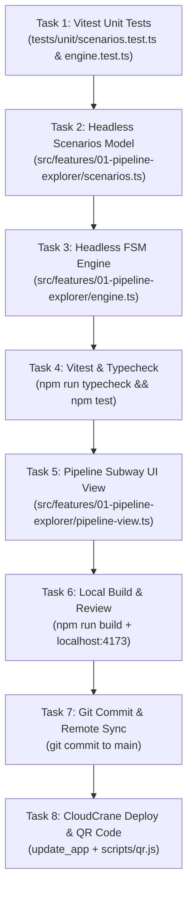

# Feature 01: Pipeline Lifecycle Explorer — Implementation Plan

This plan follows the strict **Test-Driven Development (TDD)** mandate and the **4-step build and deployment pipeline** codified in [plan.md](file:///home/rohitimandi/Desktop/Rohit/Personal/Online_Project_Uploads/Interview-Assignments/cloud-crane/plan.md) and [AGENTS.md](file:///home/rohitimandi/Desktop/Rohit/Personal/Online_Project_Uploads/Interview-Assignments/cloud-crane/AGENTS.md).

---

## 1. Task Breakdown

---

## 2. Detailed Task Specifications

### Task 1: Automated Unit Tests (Strict TDD)
- **Files**:
  - `tests/unit/scenarios.test.ts`
  - `tests/unit/engine.test.ts`
- **Test Cases**:
  - Verify all 8 scenario presets (`201-created`, `401-unauthorized`, `403-forbidden`, `429-ratelimit`, `504-timeout`, `slow-query`, `idempotency-replay`, `409-conflict`) have valid node contracts, status codes, non-empty stage payloads, and educational guidance descriptions.
  - Test FSM transitions: `READY` $\to$ `IN_FLIGHT` $\to$ `STEPPING` $\to$ `HALTED_SUCCESS` / `HALTED_ERROR`.
  - Test single-stepping forward (`stepForward()`) and boundary conditions (cannot step past final hop).
  - Test stepping backward (`stepBackward()`) reversing from upstream to downstream.
  - Test scenario switching resets state to `READY` at Node 0.
  - Assert zero DOM dependencies (`window`, `document` are undefined).

### Task 2: Headless Scenarios Model
- **File**: `src/features/01-pipeline-explorer/scenarios.ts`
- **Deliverables**:
  - Export strongly-typed `SCENARIOS` dictionary and helper `getScenario(id)` supporting all 8 presets.
  - Realistically populate wire payloads and educational guidance:
    - 201 Created: Client POST, TLS handshake, Nginx routing, Express auth, PostgreSQL insert.
    - 401 Unauthorized: Malformed/expired JWT token caught at Express auth.
    - 403 Forbidden: Valid JWT token but `Viewer` role rejected by RBAC guard for mutating endpoint (`POST /checkout`).
    - 429 Too Many Requests: Depleted token bucket at API Gateway returning `Retry-After: 1`.
    - 504 Gateway Timeout: DB connection lock exceeding 5000ms proxy SLA.
    - Slow Query: Degraded database execution ($1200\text{ms}$ vs $15\text{ms}$) with `X-Query-Time` header.
    - Idempotency Replay: Duplicate `Idempotency-Key` returning cached `200 OK` from Gateway.
    - 409 Conflict: CAS optimistic concurrency lock collision during stock decrement.

### Task 3: Headless FSM State Machine Engine
- **File**: `src/features/01-pipeline-explorer/engine.ts`
- **Deliverables**:
  - Strongly-typed `PipelineEngine` class implementing states, directions, transitions, and event subscribers (`on`, `off`).
  - Timer-based auto-stepping for `IN_FLIGHT` mode with configurable hop delays.
  - Deterministic step-forward and step-backward logic respecting scenario halt nodes.

### Task 4: Unit Test & Typecheck Verification
- Run `npm run typecheck && npm test` $\to$ Assert **0 type errors** and **100% test pass rate** across all unit tests before proceeding to UI integration.

### Task 5: Presentation Component (Subway Rail, Isometric Map & Controls)
- **File**: `src/features/01-pipeline-explorer/node-component.ts`
- **Deliverables**:
  - Vertical subway rail and 2.5D Isometric Network Map connecting the 6 nodes ([01] CLIENT, [02] DNS & TLS, [03] LOAD BALANCER, [04] API GATEWAY, [05] BACKEND APP, [06] DATABASE) with mechanical styling.
  - Node cards and isometric tech icons with index badges, IP labels, and status badges (`IDLE`, `ACTIVE`, `PASSED`, `ERROR`).
  - Animated packet bead and glowing transit wires with directional propagation.
  - Floating mechanical action bar with tactile drop shadows:
    - `[ ▶ PLAY ]` / `[ ⏸ PAUSE ]`
    - `[ ⏭ STEP FWD ]` / `[ ⏮ STEP BACK ]`
    - `[ 🔍 INSPECT WIRE ]`
    - `[ ℹ SCENARIO INFO ]` (opens dedicated educational guidance modal)
    - `[ ↺ RESET TO CLIENT ]`
  - Tactile dropdown button for scenario selection: `[ SCENARIO: Happy Path (Standard Checkout) ▾ ]`.
  - Lab Controls drawer with interactive toggles, `[ 💾 SAVE CONFIG ]`, and `[ ↺ RESET TO DEFAULT ]`.
  - Dual view toggle buttons: `[ ❖ NETWORK ]` and `[ ☰ SEQUENCE ]`.
  - Theme compatibility across both `CRT_DARK` and `PAPER_LIGHT`.

### Task 6: Local Compilation & Built-in Browser Review
- Update `scripts/bundle.js` to bundle feature modules cleanly into `dist/index.html` ($<1\text{ MB}$).
- Start local preview server and inspect `http://localhost:4173/` in the IDE built-in browser.
- Verify touch targets ($\ge 44\times 44\text{px}$), safe-area insets, and smooth $60\text{ fps}$ transitions.

### Task 7: Git Commit
- Stage verified files and commit to git on branch **`main`** with semantic commit message.

### Task 8: CloudCrane Deploy & QR Code
- Pre-flight check via `check_publish` (assert 0 problems, 0 warnings).
- Deploy updated bundle via `update_app` on slug `requestflow-v0o76jkwr0`.
- Verify live mobile rendering via `look_at_app`.
- Refresh and display scannable physical phone QR code via `cloudcrane-qr`.

---

## 3. Review Checklist for Feature 01
- [ ] Intent clearly addresses problem statement and learning goals.
- [ ] Spec details FSM states, data models, event interfaces, and visual constraints.
- [ ] Headless core code is strictly isolated from DOM APIs for fast Vitest execution.
- [ ] Plan aligns with the 4-step build and deployment pipeline.
